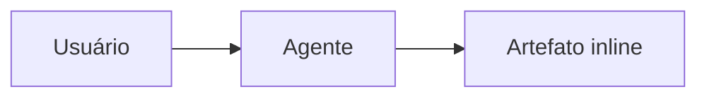

# Inline Artifacts (OpenCode)

## What renders inline
- **SVG** — vector graphics, icons, charts
- **HTML blocks** — cards, tables, styled divs (sanitized, no JS)
- **Mermaid** — diagrams via ```mermaid fenced blocks
- **Markdown** — tables, lists, code, callouts

## What does NOT work inline
- JavaScript execution (onClick, scripts) — stripped by renderer
- `contenteditable` / form inputs — not interactive inline
- External resources (CDN scripts, iframes) — blocked

For interactive/editable content, use `artifact-balloon` (opens full HTML in Review pane).

## Decision guide
| Need | Approach |
|------|----------|
| Static visual / diagram | Inline SVG or Mermaid |
| Styled card / table | Inline HTML (divs with inline styles) |
| Editable / interactive | `artifact-balloon` → Review pane HTML |
| Large document | `md-document` skill |

## Rules
1. Never paste raw code fences for HTML/SVG — render them directly in the message.
2. Keep inline HTML self-contained (inline styles only, no `<script>`).
3. For Mermaid, use fenced ```mermaid blocks.
4. If interactivity is needed, fall back to `artifact-balloon`.

## Example — inline card
<div style="display:inline-flex;align-items:center;gap:10px;padding:12px 18px;border:1px solid #334155;border-radius:12px;background:#1e293b;color:#e2e8f0;font-family:system-ui;font-size:14px;">
  <span style="font-size:20px;">📊</span>
  <div>
    <div style="font-weight:700;">Card inline</div>
    <div style="color:#94a3b8;font-size:12px;">renderizado na conversa</div>
  </div>
</div>

## Example — inline SVG
<svg width="200" height="80" xmlns="http://www.w3.org/2000/svg">
  <rect width="200" height="80" rx="12" fill="#1e293b" stroke="#6366f1" stroke-width="2"/>
  <text x="100" y="46" text-anchor="middle" fill="#e2e8f0" font-size="16" font-family="system-ui">Artefato inline</text>
</svg>

## Example — Mermaid


## Companion skills
- `artifact-balloon` — for interactive/editable HTML in Review pane
- `web-artifacts-builder` — for React/TSX bundles
- `md-document` — for long-form markdown → HTML
